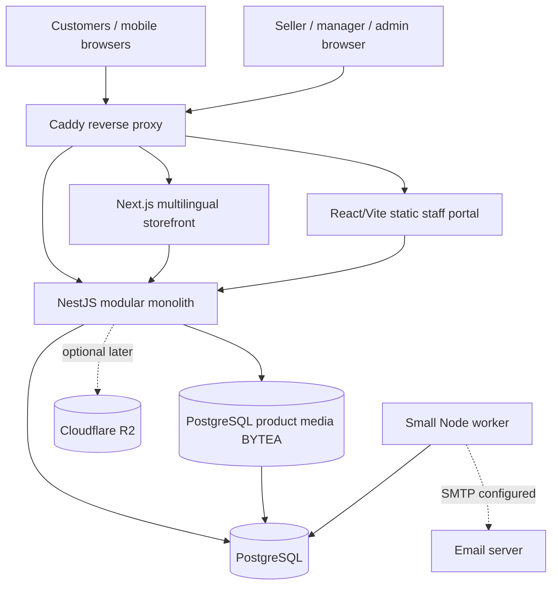

# Implemented architecture — Empreinte Flex 2.0 MVP

This codebase is based on `reference/MVP_ARCHITECTURE.md` and its API/data contract. It builds the **retail MVP now**, preserving boundaries for more showrooms, native apps and future hotel/partner B2B. It is not an enterprise ERP.

## C4 container context

## Business modules

- **Identity:** Postgres sessions with opaque cookie hashes; staff/customer roles, showroom-scoped employee grants. Technical operator has no automatic customer-data authority.
- **Catalog:** categories and products, variants, dimensions, current price with price history, PostgreSQL-backed product images with optional R2 adapter for future migration.
- **Inventory:** single writer to stock balances via `changeStock`. All balance mutations include matching immutable `stock_movements` in the same transaction.
- **Commerce:** POS sales, online pending orders, item snapshots, idempotency, stock reservations, cancellation/expiry, fulfillment and cash returns.
- **Customers:** personal retail contacts and purchase history; walk-ins need no account; no B2B tables.
- **Operations:** audit records, cash-flow summary, Postgres outbox and worker, database migration/seed routines.

## Invariants and data flow

**Stock:** `stock_balances` primary key `(location_id, variant_id)`, `on_hand>=reserved>=0`. DB conditional updates provide concurrency safety. Inserting the corresponding movement happens in the same transaction. For multi-variant orders, variants are sorted by UUID to keep lock order deterministic.

**POS:** `POST /v1/pos/sales` -> session/role check -> DB transaction -> idempotency row locked -> authoritative variant price -> order + item snapshots -> conditional stock decrement -> payment + fulfillment -> stock journal + audit + outbox -> commit -> receipt response.

**Online:** `POST /v1/checkout/orders` -> guest/registered buyer -> server reprices -> chooses a single eligible stock location for the MVP -> order + items -> conditional reserved increase -> reservations by order *line* -> tracking token hash -> outbox -> commit. Confirmation holds reservation; cancellation/24h expiry releases; fulfillment atomically decrements `on_hand` **and** `reserved`. Online orders remain UNPAID until a real payment is recorded.

**Idempotency:** `idempotency_records(scope,idempotency_key)` unique, request SHA256 compared under `FOR UPDATE`. Successful operation and persisted response commit atomically. Clients generate a random key before each new sale and reuse the same key only for retries.

**Permissions:** users have explicit `user_role_grants`; staff commands check both role and `location_id`; company-wide admin rights are explicit. Public order tracking requires the 256-bit opaque token returned once at checkout; stored hash prevents token enumeration from the DB.

**Future:** add new client apps through `/v1` without direct DB access; open showrooms by adding locations; add B2B organizations/buyer accounts later with additive SQL, not fake future tables today. If split fulfillment becomes necessary, existing order lines and fulfillment rows can be extended to allocate quantities across sources.

## Intentional architecture compromises

A solo-maintained, small-scale codebase uses NestJS controllers and application services with targeted transaction scripts. PostgreSQL transactions and constraints implement key invariants. Drizzle mappings are present and used for simple typed reads; SQL is used for complex transactional writes, not generic repository boilerplate. Not every feature has a formal DDD aggregate or abstract interface because this would add maintenance cost without solving a real problem.

**Availability:** one 8 GB / 2-vCPU VPS is a single point of failure. Safe retries + backups do not make it highly available. Offline POS and database failover are distinct future projects.
